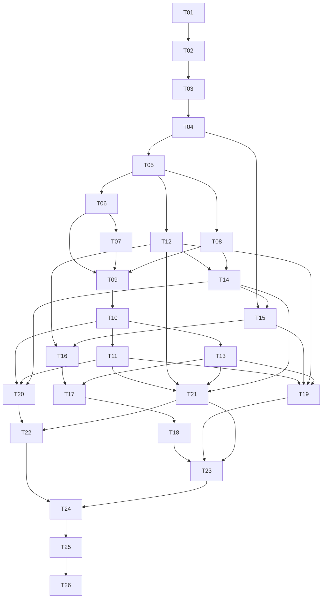

# Backlog triển khai theo phụ thuộc

Bản backlog gốc ngày 19/11/2026. Cập nhật 20/11/2026: **Task 02 Project Foundation** ([FOUNDATION_VERIFICATION](docs/FOUNDATION_VERIFICATION.md)), **Task 03 & Task 04 PostgreSQL Schema + DB Business Logic** (22 bảng, `001`–`016`, 94/94 DB tests), **Task 05 Authentication + RBAC** (Auth + Users API) và **Task 06 Catalog Backend** (Categories, Brands, Product Types, Products filter/sort/detail, Variants, Images, Banners public/admin + `002_multibrand_demo.sql` 6 ngành hàng) đã hoàn tất kiểm chứng ([SCHEMA_VERIFICATION](docs/SCHEMA_VERIFICATION.md)). Cart/checkout/orders/inventory/vouchers/reports REST API, UI nghiệp vụ và benchmark 50k–100k đơn chưa triển khai; không đánh dấu T01 hoặc các quyết định kinh doanh pending là đã duyệt. G/U/D và FR/NFR theo [PRD](docs/PRD.md); quyết định theo [DECISIONS](docs/DECISIONS.md).

## 1. Cách dùng và dependency graph

Owner là vai trò chịu trách nhiệm, không phải người đã được giao việc. Quy mô S/M/L là tương đối, chưa là lịch hoặc ước lượng ngày công. P0=nền tảng/toàn vẹn, P1=đủ trải nghiệm bản đầu; cả hai cần đạt để nghiệm thu. Mỗi task dưới đây có dependencies xuất hiện trước nó, có thể tách subtask khi thực thi nhưng không bỏ acceptance criteria.

Graph là lộ trình chính để nhìn nhanh; cột Depends trong bảng là danh sách phụ thuộc đầy đủ và có thẩm quyền khi hai cách trình bày khác nhau.

## 2. Backlog có thứ tự topological

| ID | Mức/quy mô/owner | Depends | Yêu cầu | Deliverable và acceptance criteria |
| --- | --- | --- | --- | --- |
| T01 | P0/M PO+Architect | — | Tất cả FR, D-01..11,13 | Ghi lựa chọn/owner/ngày cho schema và chính sách; chốt giá/ship, SKU, snapshot, preview, cancel, grants, brand/gallery/banner, auth, báo cáo và retention. Không đổi SPEC; mọi thay đổi được phản ánh đồng bộ 6 docs |
| T02 | P0/M Tech lead+Ops | T01 (user cho phép riêng foundation) | NFR-02,04,12; D-12 | Hoàn tất foundation 20/11/2026: npm workspaces, TS/ESLint, Compose PostgreSQL17.9, pg Pool, React Router và stack chỉ định, env, scripts, README; SQL up/down + PLpgSQL trên DB tạm, build/lint/typecheck và 9 tests đạt; health/readiness thật đã kiểm chứng. Chưa làm schema/nghiệp vụ hoặc full auth T04; cảnh báo dev-tool audit ghi trong FOUNDATION_VERIFICATION |
| T03 | P0/L DB engineer | T02 | FR-04,13–16,18,23–24; NFR-01,12 | Đã hoàn tất đủ 22 bảng (20/11/2026): migrations `001`–`014`, PK/FK/UNIQUE/CHECK/NOT NULL, `NUMERIC(12,2)`, 73 indexes, 9 views, 3 DB roles + `roles_backup.sql`, metadata 6 `product_types`, `001_demo.sql`, `checkout_requests`, `audit_events`, `ERD.md`, `MIGRATION_GUIDE.md`, `SCHEMA_VERIFICATION.md` |
| T04 | P0/L Backend+DB | T03 | FR-01,19,21; NFR-03,04 | Auth functions/JWT/password hashing, register tạo cart, role/version checks, admin cuối; middleware/envelope/error mapping/pools/transaction helper. Không role injection; inactive và token cũ bị chặn; runtime không owner/critical DML; no secret in Vite/logs |
| T05 | P0/L DB engineer | T04 | FR-02–04,13–16 | Catalog functions/views, brand/category/type/variant/price/gallery; variant+options+inventory0 atomic. 6 types hợp lệ; missing/extra/cross-value/duplicate combo reject; publish thiếu ảnh/SKU reject; price≤list_price nếu có; catalog locks đúng thứ tự |
| T06 | P0/M DB+Backend | T05 | FR-05; NFR-01 | Cart functions khóa giỏ, version, add/upsert/set/delete, giới hạn 100 dòng/999 quantity. Không trừ kho; thêm đồng thời không lost update; inactive item còn trong read model với cảnh báo; server subtotal đúng |
| T07 | P0/L DB engineer | T06 | FR-06,17; D-01,04 | Voucher functions, preview server cart, partial unique APPLIED, immutable terms sau usage; rounding và inclusive endpoints. Preview không write; cap/fixed/min/time/used/limit đúng; update used_count trực tiếp bị cấm |
| T08 | P0/M DB+Backend | T05 | FR-12; NFR-01,07 | sp_import_inventory và ledger constraints, import idempotency key. Nhập dương cộng/log cùng commit; retry cùng actor/key chỉ một log; payload khác conflict; không quantity overflow hoặc sửa/xóa log |
| T09 | P0/L DB+Backend | T06,T07,T08 | FR-07–08,16; NFR-01,07 | fn_place_order, checkout_requests completion trigger, expected_items/version, locks và snapshots. Đơn/items/stock/ledger/usages/key/cart atomic; same-key replay cùng order_id; same-key khác payload409; price/cart mismatch409; chưa xóa giỏ khi lỗi |
| T10 | P0/L DB+Backend | T09 | FR-09–11; NFR-01 | Status/cancel functions, finalized/order_items guards, multi-SKU return, voucher release. Chỉ đúng state graph; DELIVERED⇔PAID cùng delivered_at; lần hủy hai409; chỉ một hoàn; inactive SKU vẫn hoàn; owner check nằm ở DB |
| T11 | P1/M DB+Backend | T10 | FR-20,24; NFR-11,13 | Hai views báo cáo + API reports/audit read; event writers trong mutation functions đã triển khai T04–T10. Revenue không double-count, theo delivered_at local day; rank ties đúng; chỉ M/A xem reports, A xem audit; log không secret/PII đầy đủ |
| T12 | P1/L Backend+DB | T05 | FR-02–04,13–16,18 | Public/admin catalog REST + content/banner functions/APIs, options metadata. Tất cả route trong API §4/9 cho catalog/content chạy; public không lộ inactive/draft; lọc giá+tồn cùng SKU; gallery cross-product reject; banner link/schedule hợp lệ; không upload control giả |
| T13 | P0/L Backend | T10 | FR-05–12,17,19,21 | Cart/voucher/order/inventory/user REST, status/error allowlist, pagination, idempotency headers. Giữ route G, complete DTO/API_CONTRACT; checkout201 mới/200 replay/409 domain; ownership404; W không xem order detail, A không checkout; success chỉ sau COMMIT |
| T14 | P1/M Data+PO | T08,T12 | FR-03–04,13–18,22 | Seed demo có metadata được duyệt, 5 role fixtures, ảnh gốc giữ nguyên/asset sao chép. Xác nhận mapping 4/5 hoặc giữ tách, không claim giá/brand thật; đủ fixture 6 type dù thiếu ảnh thật; stock seed qua import, balance=sum ledger |
| T15 | P1/M Frontend | T04,T12,T14 | FR-01,21; NFR-09,10,13 | App shell/storefront/admin layout/router, auth memory, guards, sidebar role, design tokens/loading/error/404/403. Role landing đúng; reload auth theo D-10; deep link hoạt động, không secret/cache PII lẫn user |
| T16 | P1/L Frontend | T15 | FR-02–04,14–16,18 | Home/brand/category/catalog/detail/galleries/6 loại options. URL filters/sort/page đồng bộ; option đúng SKU; không giả color/size; list_price chỉ đúng selected SKU; stock0 disables; keyboard/mobile đọc được |
| T17 | P0/L Frontend | T13,T16 | FR-05–08; NFR-07 | Cart/COD checkout/preview/conflict flow, idempotency key lifecycle. Client không tính tiền có thẩm quyền; 409 yêu cầu review; timeout retry cùng key/body; không đổi mã voucher tự động hoặc báo thành công khi chưa có order |
| T18 | P1/M Frontend | T17 | FR-09–10 | Order history tabs/detail/success/cancel dialog. Snapshot không đổi khi catalog đổi; owner scope; chỉ PENDING/CONFIRMED có hủy; stale status refresh; COD success hiện UNPAID, không gọi là đã thanh toán |
| T19 | P1/L Frontend | T11,T12,T13,T15 | FR-11–24 liên quan admin | Toàn sitemap admin: orders/inventory/ledger/products/SKU/gallery/brands/categories/vouchers/banners/users/reports/audit. Role deny/menu đúng; warehouse reference không lộ PII; terms locked/primary/publish gates; không sửa raw totals/kho/đơn cuối |
| T20 | P0/L QA+DB | T10,T11,T14 | NFR-01,03; FR-21 | Bộ test DB invariants/privileges/snapshot theo V03,V05,V07–V14,V17–18 bên dưới. Chạy trực tiếp runtime role để xác nhận không bypass; deferred check lỗi khi COMMIT; SQLSTATE mapping cố định; fixtures reset độc lập |
| T21 | P0/L QA+Backend | T11,T12,T13,T14 | Tất cả API; NFR-03,04 | Contract+RBAC integration cho tất cả routes, DTO/money/null/pagination/static route precedence/unknown fields. Mỗi endpoint có allow/deny, ownership, invalid token/active; lỗi không SQL/stack; tổng hợp matrix và log kết quả |
| T22 | P0/L QA+DB | T20,T21 | FR-08,10; SPEC §7 | Concurrency/rollback tests V01–V06,V15–V16 có barrier/5 sessions độc lập. Đạt đúng stock201/409, voucher1, rollback món2, cancel một lần, same-cart/key/import retry; lặp fixture đủ để phát hiện race, lưu counts/ledger/keys |
| T23 | P1/L QA+Frontend | T18,T19,T21 | NFR-09,10,13–14 | E2E storefront/admin, 6 type option flows, keyboard/screen reader spot-check, mobile 360..1440, empty/loading/error, IDOR. Không horizontal overflow toàn trang; labels/focus/contrast; deep links/title; không tuyên bố AA chỉ vì automated audit pass |
| T24 | P1/L QA+DB+Ops | T11,T14,T20,T22,T23 | FR-22; NFR-05,06,11; D-14 | Seed 50k–100k orders+items, 10k SKU, EXPLAIN ANALYZE BUFFERS trước/sau indexes; p95/API/load profile và web vitals theo PRD. Ghi CPU/RAM/PG version/data size/warm-cache/network; target chưa đạt thì sửa nguyên nhân hoặc PO duyệt lại, không sửa số đo |
| T25 | P0/L Ops+Security | T24 | FR-23; NFR-03,04,07,08,11–12 | Deploy pilot, HTTPS/CORS/rate/body/timeouts/pool, health/readiness, logs redaction, backup và restore rehearsal DB khác. Kiểm roles/functions/row counts/sample order sau restore, đo RPO/RTO; không deploy production khi retention/secrets/hạ tầng chưa chốt |
| T26 | P0/M PO+QA+Tech lead | T25 | Tất cả FR/NFR | UAT theo V01–V18 và sitemap, đóng decision pending cần thiết, runbook fresh setup/migrate/backup/rollback/test/demo. Review không có scope cấm/ORM; bằng chứng tests/build/benchmark, giới hạn và rủi ro được ghi; PO nghiệm thu bản phát hành |

Nếu dependency chỉ cần interface đã ổn định, đội triển khai có thể làm UI trên mock contract sau T01; không dùng mock pass thay nghiệm thu backend/DB thật. Không ấn định làm song song bằng agent trong task hiện tại.

## 3. Verification matrix và acceptance chi tiết

Tất cả dữ liệu test ở DB tách biệt. Không dùng tài khoản/đơn thật. Expected HTTP dưới đây theo API_CONTRACT, các D liên quan phải được chốt trước chạy acceptance.

| ID | Setup / thao tác | Kết quả bắt buộc | Task |
| --- | --- | --- | --- |
| V01 | 5 CUSTOMER, 5 carts, keys khác nhau; cùng SKU stock=1; gửi 5 checkout qua barrier | Chính xác 1×201,4×409 OUT_OF_STOCK; stock0; 1 order/item/EXPORT; giỏ thua không mất; không key pending | T22 |
| V02 | 5 user chưa dùng voucher, stock dư, remaining usage=1; checkout cùng mã | 1 đơn có APPLIED,4×409 VOUCHER_EXHAUSTED; used_count=limit; losers không tự thành đơn không voucher; stock losers không giảm | T22 |
| V03 | Cart 2 SKU, inject failure sau xử lý món1/trước hoàn thành món2 | Orders/items/EXPORT/usages/key/audit không có phát sinh; stocks/counter/cart/version như trước; không failpoint ở production | T20,T22 |
| V04 | Đơn 2 SKU + voucher; 2 cancel tuần tự và song song | 1×200,1×409; stock từng SKU + đúng quantity một lần, 2 RETURN logs; usage RELEASED, counter -1 một lần | T22 |
| V05 | Đơn có snapshot; sửa product/brand/price/list_price; thử UPDATE/DELETE items và order cuối | Hóa đơn giữ tên/options/giá cũ; runtime DML denied; guard chặn xóa/sửa lịch sử; subtotal khớp items | T20 |
| V06 | Checkout success nhưng bỏ HTTP response; retry cùng key/body; đổi body cùng key | Replay200 cùng order_id/totals, không trừ thêm; body khác409; key rollback khi checkout thất bại cho phép retry sau khi sửa nguyên nhân | T22 |
| V07 | 6 type configs; thiếu required, extra axis, value sai axis, duplicate axis/combination, empty axis type cho phép | Chỉ SKU hợp lệ được tạo; một inventory0/SKU; no fake N/A; empty combo chỉ một/product khi schema cho phép | T20,T21 |
| V08 | 2 product; ảnh SKU của product khác, 2 primary cùng scope, xóa ảnh cuối active product | FK/constraint/API reject; primary đổi atomic; fallback SKU→product ổn định; không xóa ảnh gốc | T20,T21 |
| V09 | Phiên JWT C cũ sau role/active đổi; role injection register; khách gọi mọi endpoint admin, user khác xem order | Register luôn C; token cũ401; admin route403; order người khác404; A không checkout; DB function deny sai actor role | T20,T21 |
| V10 | Voucher FIXED>subtotal, PERCENT/cap, min exact, time start/end exact, expired sau khi chờ lock; release rồi dùng lại | Discount 0..subtotal, round đồng; time inclusive G; không dùng timestamp trước chờ; preview không write; release được dùng lại | T20,T21 |
| V11 | PENDING nhảy DELIVERED; S chuyển SHIPPING trong lúc C cancel; đã DELIVERED/CANCELLED bị mutation | Nhảy bước409; lock winner quyết định trạng thái; không hoàn sau SHIPPING; DELIVERED iff PAID/delivered_at; cuối immutable | T20,T21 |
| V12 | 2 orders delivered có nhiều items, 1 pending/1 cancelled; delivered_at ranh giới local month; ties lượng | SUM(order.final) đúng một lần/order, không tính đơn khác; ngày/tháng local đúng; RANK đồng hạng; SKU gross không gọi net | T20,T21 |
| V13 | SKU rẻ hết hàng + SKU đắt còn hàng; query min/max chỉ khớp SKU rẻ và in_stock=true | Product không xuất hiện khi không có một SKU thỏa đồng thời; public draft/inactive 404, order history vẫn xem được | T20,T21 |
| V14 | app_rw/report_ro gọi DML/function ngoài allowlist, CREATE schema, xem hashes/PII qua public projections | Critical DML/DDL denied; report role chỉ views; PUBLIC không EXECUTE mutation; runtime không schema owner; SELECT DTO không leak | T20,T21 |
| V15 | 2 checkout khác key trên cùng cart, mutation cart đồng thời, price change trước/sau khóa | Tối đa 1 order trên version; loser CART_CHANGED/CART_EMPTY; không mất item mới; price mismatch409 trước trừ kho; không đơn sai subtotal | T22 |
| V16 | 2 import same actor/key/body, different body same key, import/cancel/checkout chung SKU | Import effect một lần; different body409; balance=sum ledger, không âm/overflow, không deadlock treo vô hạn | T22 |
| V17 | Banner trước/đúng start/đúng end, target inactive; 2 admin cùng hạ quyền nhau | Banner hiện [start,end), inactive target ẩn; ít nhất một active ADMIN sau cả transaction | T20,T21 |
| V18 | Commit request thiếu order_id, item thiếu/zero subtotal sai, ledger sign/reference sai, usage counter drift | Deferred/row constraints reject và rollback; audit mutation thất bại không lưu; SUM ledger và used_count reconciled | T20 |

Stock và voucher race là hai test độc lập; không dùng same-cart/key làm fixture V01 vì sẽ test idempotency thay tranh tồn. Các lỗi DB retry phải retry whole transaction, không retry chỉ câu SQL cuối. Benchmark không đặt target “luôn nhanh hơn” vô căn cứ: ghi plan/time/buffers đúng dữ liệu và giải thích index hữu ích/không hữu ích.

## 4. Truy vết FR/NFR tới task

| Yêu cầu | Task chính |
| --- | --- |
| FR-01 | T04,T15,T21 |
| FR-02–04 | T03,T05,T12,T16,T20 |
| FR-05 | T06,T13,T17 |
| FR-06 | T07,T13,T17 |
| FR-07–08 | T09,T13,T17,T22 |
| FR-09–11 | T10,T13,T18,T19,T22 |
| FR-12 | T08,T13,T19,T22 |
| FR-13–16 | T03,T05,T12,T14,T16,T19 |
| FR-17 | T07,T13,T19 |
| FR-18 | T03,T12,T16,T19 |
| FR-19 | T04,T13,T19,T21 |
| FR-20 | T11,T19,T24 |
| FR-21 | T04,T20,T21 |
| FR-22 | T14,T24 |
| FR-23 | T02,T03,T25 |
| FR-24 | T03,T04–T13,T19,T20 |
| NFR-01 | T03,T05–T10,T20,T22 |
| NFR-02,12 | T02,T03,T25 |
| NFR-03,04 | T04,T20,T21,T25 |
| NFR-05,06 | T24 |
| NFR-07 | T08–T10,T17,T22,T25 |
| NFR-08 | T25 |
| NFR-09,10 | T15–T19,T23 |
| NFR-11 | T11,T24,T25 |
| NFR-13 | T11,T15–T19,T23 |
| NFR-14 | T16,T23 |

## 5. Definition of Ready và Definition of Done

Ready: phạm vi task cụ thể, contract/schema và D ảnh hưởng được chốt hoặc người dùng đã cho phép dùng phương án khuyến nghị; dependency có interface/bằng chứng phù hợp; DB test và fixture sẵn có. Không hỏi lại những quyết định đã được người dùng chấp thuận trong phiên.

Done cho task code sau này: deliverable khớp docs, migration SQL có phiên bản, validations và error codes đồng bộ, tests cần thiết có kết quả thật, typecheck/build đạt, không secret/ORM/scope cấm, tài liệu thay đổi được cập nhật. Không đánh dấu test pass vì đã viết test hoặc mock response đúng. UI low-risk không cần unit test chỉ lặp implementation, nhưng flow nghiệp vụ/concurrency/RBAC là kiểm thử bắt buộc.

Release gate: T20–T25 có bằng chứng, 4 nhóm SPEC §7 đạt, D ảnh hưởng đã chốt, PO UAT chấp nhận. Không tự commit/push/deploy trong task tài liệu hiện tại; khi nhận task tiếp theo thực hiện đúng phạm vi được giao.

## 6. Rủi ro còn mở và đầu vào

Ưu tiên chốt D-01/02/07/08/13 trước schema, D-03..06 trước checkout, D-09..11 trước các API tương ứng. Cần xác minh lại PostgreSQL/Docker khi tới T02, không coi audit cũ là trạng thái máy hiện tại. Có Git hiện tại; không tạo repo mới.

PO còn cung cấp/chấp thuận: tên/logo cửa hàng, hero rõ nét, brand/category chính thức, mapping ảnh4/5 và brand ảnh3/6, giá/size/SKU/tồn, phí ship, retention PII, hạ tầng/backup owner. Các mục O trong PRD chưa có task triển khai; không tự thêm wishlist/blog/online payment/AI/multi-warehouse.
