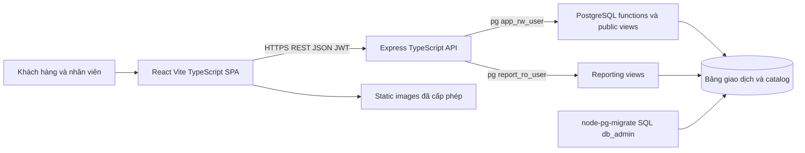

# Kiến trúc hệ thống bán lẻ

Cập nhật vận hành Task15 (20/11/2026): xem [DEPLOYMENT](DEPLOYMENT.md), [OPERATIONS](OPERATIONS.md) và [FINAL_HANDOVER](FINAL_HANDOVER.md) cho hiện trạng triển khai/kiểm chứng. Các đoạn “chưa có ứng dụng” và sơ đồ reporting pool dưới đây là snapshot thiết kế ban đầu. Runtime hiện có API/UI đầy đủ và **một pool app_rw_user**, reports qua SECURITY DEFINER có actor checks; chưa có report pool/read replica. Production profile, image, CI và restore drill local đã được chuẩn bị, chưa deploy cloud/go-live.

Thiết kế 1.0, 19/11/2026. Ràng buộc G/U theo [PRD](PRD.md); các cơ chế mới là D theo [DECISIONS](DECISIONS.md). Đây là thiết kế để review, không có ứng dụng đang chạy.

Cập nhật 20/11/2026: Task 02 đã tạo foundation React/Express, pg Pool, health, Compose và SQL migration tooling; xem [README](../README.md) và [kết quả kiểm chứng](FOUNDATION_VERIFICATION.md). Các module nghiệp vụ và bảo mật DB mô tả bên dưới vẫn là thiết kế tương lai, chưa được thực thi. Stack bổ sung người dùng chỉ định: React Router, Tailwind CSS, shadcn/ui, TanStack Query, React Hook Form + Zod; backend JWT primitives + Zod.

## 1. Kiến trúc tổng thể

Modular monolith là phương án D-12: một React SPA, một Express API, một PostgreSQL; một kho logic thể hiện bằng inventory theo SKU, không có warehouse_id. Không microservices, broker, search engine hoặc Redis bắt buộc ở bản đầu.



Browser không có thông tin DB. pg Pool sống ở backend, tách runtime và reporting pool. db_admin chỉ dùng migration/backup có kiểm soát, không đưa vào .env runtime. Dịch vụ static phục vụ ảnh nội bộ, API không fetch URL tùy ý. Chưa thiết kế upload pipeline hay CDN bắt buộc.

| Module | Chịu trách nhiệm | Không được chuyển sang UI/backend |
| --- | --- | --- |
| Identity | Backend hash/verify password, ký JWT; DB lưu user/role/active/version và kiểm tra actor | Không tin role/user_id từ request body |
| Catalog | Brand/category/product/type/options/images/price, public projections | DB chặn combo SKU, FK ảnh, giá và trạng thái hợp lệ |
| Cart | DB một giỏ/user, version và thao tác tuần tự; UI cache trải nghiệm | Không giữ/trừ kho, không cam kết giá |
| Checkout | Function nguyên tử, idempotency, snapshots, stock/voucher/log | Không tính tổng tiền cuối ở JavaScript |
| Orders | Function status/cancel; DB bảo vệ đơn và items | Không PATCH tùy ý status/total/payment |
| Inventory | Procedure import, khóa inventory, append-only ledger | Không có endpoint sửa quantity trực tiếp |
| Campaign/content | Voucher guards và banner schedule/FKs | Preview không giữ voucher, banner không tự sửa giá |
| Reports/audit | SQL views và event cùng transaction | Không join làm nhân đôi tổng đơn; không lộ PII |

## 2. Monorepo mục tiêu

```text
database/
  migrations/        SQL up/down qua node-pg-migrate
  seeds/             demo riêng, benchmark riêng
  tests/             invariants, privileges, functions
  roles_backup.sql   role grants và hướng dẫn backup/restore
backend/
  src/{config,middlewares,controllers,services,routes,types}/
  tests/             API integration, concurrency
frontend/
  src/{pages/storefront,pages/admin,components,layouts,context,api,styles,types}/
  public/images/products/
  tests/
tests/e2e/
scripts/
docs/                bộ tài liệu hiện tại
SPEC.md              bất biến, nguồn gốc
TASKS.md
AGENTS.md
```

Root npm workspaces backend/frontend, một lockfile; TypeScript strict. Chốt phiên bản Node/npm/PostgreSQL và dependency trong T02; không dùng “latest” không khóa. Migration SQL thuần được runner quản lý, không ORM/schema sync; spike xác nhận parser up/down của node-pg-migrate trước khi viết migration thật. Không tạo thêm tầng fashion-ecommerce trong workspace hiện tại.

Runner có hỗ trợ SQL và cơ chế loader phụ thuộc phiên bản; tham khảo [node-pg-migrate migration loading strategies](https://salsita.github.io/node-pg-migrate/migration-loading-strategies). Spike phải khóa đúng phiên bản/cấu hình và chứng minh SQL up/down, không lấy cú pháp một phiên bản khác áp vào dự án chưa chọn version.

## 3. Luồng request và transaction boundary

Express: request_id → limits/CORS → parse/validate → JWT → đọc user hiện hành kiểm tra active/token_version/role → controller → service gọi SQL tham số hóa → map domain error → JSON. Unknown fields bị reject tại write API để tránh mass assignment. Các SELECT sort/order dùng allowlist, không ghép SQL từ input.

Mỗi mutation nghiệp vụ có đúng một transaction trên một pg client được checkout khỏi pool. BEGIN, SET LOCAL timeout, SELECT function/CALL procedure, COMMIT; lỗi bất kỳ ROLLBACK; release trong finally. Function không tự COMMIT. Không gửi HTTP thành công trước COMMIT. Không gọi mạng, email hoặc xử lý ảnh trong transaction.

Actor ID được lấy từ JWT đã xác minh, function tự đọc users để kiểm tra role/active; không nhận role có thẩm quyền từ client. Backend là trust boundary đối với actor: app_rw_user bị chiếm quyền có thể gọi function bằng actor khác, nên đây không phải cơ chế chống backend/DB credential bị xâm nhập. Không cấp SQL credential cho người dùng cuối.

## 4. Đồng thời và thứ tự khóa D-03

READ COMMITTED + khóa tường minh là baseline. Chưa có yêu cầu dùng SERIALIZABLE toàn hệ thống. Thứ tự dưới đây áp dụng cho mọi hàm liên quan; trong mỗi nhóm khóa theo ID tăng dần, lấy mode đủ mạnh ngay từ đầu.

1. Checkout request row theo (user_id,key); import dùng advisory transaction lock namespaced actor/key.
2. Giỏ của user (checkout và mọi mutation cart) **hoặc** đơn hiện hữu (cancel/status). Không một luồng nào khóa cả giỏ lẫn đơn hiện hữu.
3. Catalog khi cần chốt bán: brands → categories → products → product_variants. Checkout dùng FOR SHARE để giữ active/price ổn định; catalog admin cập nhật theo cùng thứ tự bằng khóa ghi. Cancel không khóa catalog vì phải hoàn cả SKU inactive.
4. Inventory theo variant_id ASC, FOR UPDATE.
5. Vouchers theo id ASC, FOR UPDATE, rồi voucher_usages của đơn/user.
6. Ghi order mới, items, ledger, audit, hoàn thành checkout_requests. Order mới chưa public không cạnh tranh với đơn hiện hữu; không khóa một order cũ sau voucher.

Preview chỉ đọc snapshot, không giữ khóa. Voucher edit chỉ khóa voucher; import chỉ khóa inventory sau key; status chỉ khóa order; quản lý role dùng advisory lock nhóm admin rồi users theo ID để bảo vệ admin cuối. Cart mutation khóa cart trước khi kiểm tra/update items; không giữ row lock users. Admin catalog không khóa inventory nếu chỉ sửa nội dung/giá; tạo variant mới và inventory trong cùng transaction.

Retry toàn transaction tối đa 2 lần cho SQLSTATE 40P01/40001, jitter nhỏ; không retry lỗi nghiệp vụ. Chờ khóa đề xuất 2s, statement 5s; timeout trả RESOURCE_BUSY 503, không giả hết hàng. Cần load test để chốt timeout D-14. Không coi thứ tự khóa là bằng chứng không thể deadlock trong mọi DDL/maintenance.

Khóa FOR UPDATE giữ đến transaction kết thúc; thứ tự nhất quán giảm deadlock nhưng vẫn cần xử lý transaction bị abort. Cơ sở kỹ thuật: [PostgreSQL explicit locking](https://www.postgresql.org/docs/current/explicit-locking.html). Thiết kế thứ tự cụ thể ở đây là quyết định của dự án.

## 5. Checkout nguyên tử

```mermaid
sequenceDiagram
  participant UI as Khách hàng
  participant API as Express
  participant DB as PostgreSQL
  UI->>API: POST checkout + key + cart_version + expected_items
  API->>DB: BEGIN và fn_place_order(actor,payload,key)
  DB->>DB: Serialize key; replay hoặc reject payload khác
  DB->>DB: Lock cart; đối chiếu version/items
  DB->>DB: Lock catalog; so giá/active
  DB->>DB: Lock inventory ASC; kiểm tra đủ từng món
  DB->>DB: Lock voucher; tính lại eligibility/discount
  DB->>DB: Insert order/items; trừ kho; ledger/usages/audit; xóa giỏ
  DB->>DB: Hoàn thành key gắn order
  DB-->>API: Receipt, replay flag
  API->>DB: COMMIT
  API-->>UI: 201 mới hoặc 200 replay
```

Chi tiết bắt buộc:

- Request key scoped theo user, payload JSONB canonical gồm shipping, voucher chuẩn hóa, cart_version và expected_items đã sort. Không đưa request_id vào payload. Cùng key/cùng payload trả cùng order_id, cùng tiền snapshot; status có thể đã tiến triển khi replay. Khác payload trả 409 IDEMPOTENCY_KEY_REUSED trước khi xét giỏ.
- checkout_requests insert reservation trước khi khóa cart; unique conflict chờ transaction trước. Bản ghi pending chỉ tồn tại trong transaction, deferred constraint trigger yêu cầu order_id có giá trị khi COMMIT. Thất bại rollback cả key; không có key FAILED bền vững. Không purge keys v1; thời hạn lưu cần D-13 trước production.
- Cart tạo ngay khi đăng ký; user cũ backfill migration. cart_version tăng mỗi mutation và khi checkout thành công. Checkout phải có ít nhất một item. expected_items phải đúng toàn bộ SKU/quantity/price, không nhận subtotal/final_amount có thẩm quyền từ client.
- Sau khi khóa giá, subtotal = SUM(price × quantity). D-01: discount phần trăm làm tròn đến đồng, clamp 0..subtotal; final=subtotal-discount. list_price không tham gia thanh toán. Bảo vệ overflow NUMERIC và quantity/int.
- Giá hoặc active có thể đổi trước khóa; đọc lại dưới khóa, giá khác expected → 409 PRICE_CHANGED. Không tự chấp nhận giá cao/thấp khác số khách đã duyệt.
- Một voucher hoặc không; voucher lock bao quanh eligibility + counter + APPLIED usage. Một tài khoản tối đa một APPLIED/voucher, RELEASED cho phép dùng lại. Chỉ khóa lượt tại checkout, không ở preview/cart.
- Trừ đủ kho, ghi EXPORT_ORDER từng SKU, chèn snapshots, xóa giỏ và tăng version trong cùng transaction. Lỗi món bất kỳ phải rollback cả những món đã xử lý, used_count, key, audit và order.
- UI giữ key/payload khi mất kết nối để retry xác định kết quả. Cart thay đổi sau success không ảnh hưởng replay. Khi lỗi nghiệp vụ đã trả dứt khoát và khách sửa dữ liệu, dùng key mới.

Hai checkout khác key cùng cart bị tuần tự hóa: request sau gặp CART_CHANGED/CART_EMPTY, không tạo đơn thứ hai. Hai checkout cùng key trả cùng một đơn; fixture test tranh stock phải dùng 5 CUSTOMER/5 giỏ độc lập, không trộn với test idempotency.

## 6. Cancel, trạng thái, nhập kho

Cancel khóa order; kiểm tra actor sở hữu hoặc SALES/ADMIN trước khi đọc PII; chỉ PENDING/CONFIRMED. Kiểm tra không có RETURN_CANCEL của order trước vòng lặp. Khóa inventory ASC, khóa voucher nếu có; hoàn từng SKU, append RETURN_CANCEL, RELEASED và counter -1, set CANCELLED/UNPAID, audit cùng transaction. CANCELLED gọi lại → 409, không thêm side effect (D-06). Sửa status đồng thời và cancel được serialize bởi cùng order lock.

Status function nhận expected_status và target_status. Chỉ PENDING→CONFIRMED→SHIPPING→DELIVERED; nếu expected khác current, 409 STALE_ORDER_STATUS. Set delivered_at và PAID trong cùng update khi giao thành công. Trigger chặn nhảy bước, xóa orders và cập nhật sau trạng thái cuối; order_items immutable kể từ sau transaction tạo đơn, kể cả lúc PENDING. Không cho chỉnh address sau đặt ở v1.

sp_import_inventory yêu cầu quantity>0, actor WAREHOUSE/ADMIN và Idempotency-Key. Serialize actor/key bằng transaction advisory lock; lookup IMPORT ledger theo actor/key: payload (variant,quantity,note) giống trả giao dịch cũ, khác trả 409. Sau đó khóa inventory, cộng và log cùng transaction. Partial unique(created_by,request_key) cho IMPORT là lớp cuối chống trùng; key không dùng cho EXPORT/RETURN. API chỉ retry timeout với cùng key; không tự gửi lại một nhập kho mới khi không biết kết quả.

## 7. Bảo mật, roles và lịch sử

Phương án D-07 siết quyền so với DML rộng ở SPEC: app_rw_user EXECUTE hàm allowlist và SELECT views cần thiết; không direct INSERT/UPDATE/DELETE critical tables. Public catalog lấy từ views lọc active, không cho browser truy SQL. report_ro_user chỉ SELECT reporting views; db_admin sở hữu schema/chạy migrations, không superuser khi vận hành thông thường.

Mutation functions SECURITY DEFINER phải qualified object names, search_path chỉ schema tin cậy và pg_temp cuối, revoke EXECUTE FROM PUBLIC trong cùng migration, grant theo allowlist. Thu hồi CREATE schema với runtime; không dynamic SQL tùy ý. Hướng dẫn cơ chế này dựa trên [PostgreSQL CREATE FUNCTION](https://www.postgresql.org/docs/current/sql-createfunction.html); phạm vi grant là đề xuất dự án cần test.

DB functions kiểm tra actor/role và ownership cả khi backend lỡ bỏ middleware. JWT gồm id, role, ver, exp, iss, aud; DB users.token_version tăng khi đổi role/active hoặc reset quyền. JWT 30 phút/in-memory/no refresh là D-10; frontend reload yêu cầu login lại, logout xóa local token nhưng token đã bị copy chỉ hết hiệu lực khi exp/version đổi. Không tuyên bố logout local thu hồi token trên server.

Không xóa dữ liệu có lịch sử; deactivate brands/categories/products/SKU/users/vouchers/banners theo quyền. audit_events chỉ ghi whitelist field changes, không snapshot password_hash, JWT hoặc nguyên địa chỉ. Tránh log SQL parameter chứa PII. Customer chỉ xem lịch sử mình; MARKETING usage được redaction, WAREHOUSE không xem địa chỉ đơn.

## 8. Đọc báo cáo, cache và tài sản

Revenue aggregate orders trước, theo delivered_at ở Asia/Ho_Chi_Minh. Không join order_items vào SUM(final_amount). Best seller aggregate order_items chỉ từ delivered orders, RANK có tie. Reporting pool không chạy mutation functions. Giai đoạn đầu query trực tiếp view; chưa dùng materialized view/cache dẫn tới stale totals.

Public catalog có thể HTTP cache ngắn ở bước tối ưu sau nhưng stock/checkout không dựa cache; v1 chọn no-store cho cart/orders/auth và thông tin tồn chi tiết. Banner query theo lịch, thứ tự sort_order,id; ảnh fallback luôn xác định. Frontend object-fit:contain, width/height và lazy load dưới fold; không sửa ảnh gốc.

## 9. Môi trường, quan sát và phục hồi

Dev/test/prod tách DB và secret; .env.example chỉ placeholder. Không đưa DB_PASSWORD/JWT secret vào VITE_*. CORS explicit origin; HTTPS reverse proxy ở deploy, SPA deep-link fallback. Liveness không query DB, readiness query nhẹ có timeout, không trả DB host/version/secret. Pool size/connection budget phải tính theo số instance, đo ở T02/T24.

Log JSON request_id, route, status, duration, domain code; DB exception được map, không gửi SQL/stack ra client. Metric pool wait, checkout failure theo code, stock/voucher conflicts, retries và lock timeout. Request_id truyền vào audit nhưng không thay idempotency key.

Backup PostgreSQL gồm schema/data/roles cần thiết, lưu ngoài repo và kiểm soát quyền. Restore rehearsal trên DB khác và kiểm tra constraints/functions/permissions/sample order. RPO 24h/RTO 4h chỉ là target pilot D-12; lịch retention và production recovery phải được chốt. Không chạy seed benchmark hoặc migration destructive trên dữ liệu thật tự động.

## 10. Chiến lược kiểm chứng và giới hạn

Tầng DB kiểm invariant/actor/locks/snapshot; API integration kiểm status/error schema/RBAC/idempotency; E2E kiểm flow storefront/admin/responsive. Bốn bài SPEC §7 bắt buộc; thêm giá đổi, same-cart race, same-key replay, multi-SKU cancellation, inactive catalog, voucher edit race, stale role và báo cáo ranh giới ngày. Fixture và bước chạy nằm trong [TASKS](../TASKS.md).

Chưa chọn version/hạ tầng, chưa chạy benchmark, chưa có binary application. Bộ thiết kế không cam kết hiệu năng/hệ thống không lỗi khi backend credential bị chiếm. Các giả định kinh doanh D cần chốt trước code phụ thuộc.
