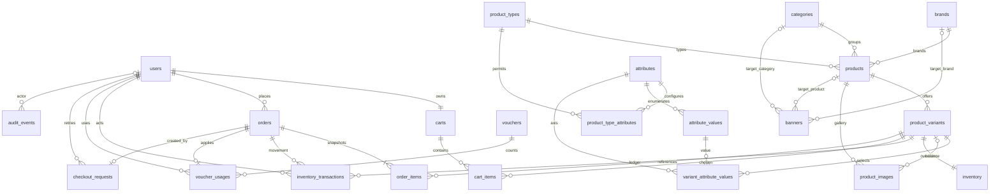

# Thiết kế cơ sở dữ liệu PostgreSQL

Bản thiết kế 1.0 — 19/11/2026. Chưa có DDL/migration được thực thi. G là 12 bảng tại SPEC §2 và DB objects §3; U là phạm vi mới; D là phương án trong [DECISIONS](DECISIONS.md), phải chốt trước migration phụ thuộc.

## 1. Mô hình, quy ước và khác biệt nguồn

22 bảng mục tiêu: 12 G + brands/product_images/banners (3 U) + product_types/attributes/product_type_attributes/attribute_values/variant_attribute_values (5 D hỗ trợ U) + checkout_requests/audit_events (2 D). Không seller, payment gateway, warehouse hoặc bảng AI.

Schema tin cậy `app`; PK INT SERIAL cho thực thể gốc giữ theo SPEC, BIGSERIAL cho ledger/audit; không tái sử dụng ID/SKU/code. INT/BIGINT dương; API serialize BIGINT thành chuỗi. `T` dưới đây = TIMESTAMPTZ, `M` = NUMERIC(12,2), `R` = NOT NULL, `?` = nullable. Trường không ghi default phải cung cấp; PK serial sinh tự động. `created_at T R DEFAULT now()` và `updated_at T R DEFAULT now()` được liệt kê ở từng bảng; trigger quản lý updated_at cho bảng mutable. Text đầu vào trim, length giới hạn theo dictionary; code/slug canonical lowercase trừ SKU/voucher uppercase.

Tiền D-01: M ≥0, scale API 2 chữ số, VND .00; không dùng float/JavaScript tính tiền. round phần trăm đến đồng, clamp subtotal, order final=subtotal-discount. Đơn vị lượng INT, không bán lẻ theo trọng lượng. Tất cả FK ON DELETE RESTRICT trừ khi ghi khác; thay bằng deactivation cho dữ liệu nghiệp vụ. Không cascade xóa đơn/lịch sử.

Giới hạn M áp dụng cột tiền lưu từng đơn/SKU; tổng hợp reporting dùng SUM NUMERIC không ép ngược về NUMERIC(12,2). Tính tổng đơn bằng numeric rộng trước khi kiểm trong miền lưu trữ, vượt miền trả AMOUNT_OUT_OF_RANGE thay vì để SQL overflow thành lỗi 500. Cart tối đa 100 dòng, mỗi dòng quantity≤999; function kiểm giới hạn dưới cart lock, DB deferred check bảo vệ trường hợp bypass.

Thay đổi có chủ ý so với G:

- products thêm brand_id/product_type_code/is_active gate; categories thêm active. product_variants thêm list_price/is_active/combo_key, thay color/size bằng quan hệ thuộc tính.
- base_image_url, image_url gốc không lưu song song với gallery; API public trả alias đọc tính từ product_images. color/size có thể trả alias khi loại có thuộc tính đó, không là cột nghiệp vụ bắt buộc.
- orders bổ sung delivered_at, voucher_code_snapshot, created_xid để bảo vệ lịch sử; order_items bổ sung snapshots để product rename không làm thay hóa đơn.
- Các điều chỉnh giá/phân quyền cần D-01/02/07/08; SPEC.md vẫn nguyên văn. Nếu có DB cũ ở bước thực thi, backfill gallery/options, kiểm trùng rồi mới bỏ cột legacy; không destructive migration tự động.

## 2. ERD

Carts/inventory là quan hệ 1–1 theo quy tắc nghiệp vụ; UNIQUE/FK chỉ bảo đảm tối đa một. Hàm register/create_variant và kiểm tra deferred bảo đảm mỗi user/SKU được commit có đúng một giỏ/inventory. Order có tối thiểu một item được kiểm bằng deferred invariant, không chỉ dựa ERD. Mỗi banner chỉ chọn một target hoặc NONE. Một order tối đa một usage; một voucher có nhiều usage RELEASED cho cùng user qua các đơn khác nhau.

## 3. Dictionary cho 12 bảng gốc

### users

| Cột | Kiểu/null/default | Ràng buộc và ý nghĩa |
| --- | --- | --- |
| id | SERIAL PK | ID nội bộ |
| full_name | VARCHAR(120) R | 1–120 sau trim |
| email | VARCHAR(254) R | Lưu lowercase/trim, UNIQUE; DB CHECK đúng canonical |
| password_hash | TEXT R | Chỉ hash adaptive; không xuất qua DTO/audit |
| phone | VARCHAR(20) ? | Chuẩn hóa định dạng; không bắt buộc ở đăng ký |
| role | VARCHAR(16) R default CUSTOMER | CUSTOMER/SALES/WAREHOUSE/MARKETING/ADMIN |
| is_active | BOOLEAN R default true | Inactive không thực hiện request cần auth |
| token_version | INT R default 0 | D; ≥0, tăng khi đổi role/active hoặc thu hồi toàn bộ token |
| created_at | T R default now() | Thời gian tạo |

### categories

| Cột | Kiểu/null/default | Ràng buộc |
| --- | --- | --- |
| id | SERIAL PK | Một cấp, không parent_id v1 |
| name | VARCHAR(120) R | UNIQUE, không rỗng |
| slug | VARCHAR(160) R | UNIQUE, canonical slug ASCII |
| description | TEXT ? | Plain text ≤10000 ký tự |
| is_active | BOOLEAN R default true | D, chặn mua product thuộc category inactive |
| created_at | T R default now() | G |

### products

| Cột | Kiểu/null/default | Ràng buộc |
| --- | --- | --- |
| id | SERIAL PK | G |
| category_id | INT R FK categories | Một category/product |
| brand_id | INT R FK brands | U, một brand/product |
| product_type_code | VARCHAR(24) R FK product_types(code) | D; không đổi khi đã có SKU |
| name | VARCHAR(200) R | Không rỗng |
| slug | VARCHAR(220) R UNIQUE | Public URL ổn định; v1 không đổi slug sau publish |
| description | TEXT ? | Plain text ≤20000, không arbitrary HTML |
| is_active | BOOLEAN R default false | Publish function yêu cầu gallery và ≥1 active SKU |
| created_at, updated_at | T R default now() | G |

### product_variants

| Cột | Kiểu/null/default | Ràng buộc |
| --- | --- | --- |
| id | SERIAL PK | G |
| product_id | INT R FK products | Bất biến sau tạo |
| sku | VARCHAR(64) R UNIQUE | Canonical uppercase [A-Z0-9-], không tái sử dụng |
| combo_key | TEXT R | D, chuỗi attribute_id=value_id sort ASC; UNIQUE(product_id,combo_key) |
| price | M R | Giá bán hiện tại ≥0, VND .00 |
| list_price | M ? | D; null hoặc ≥price, VND .00; bằng price thì không hiện gạch giá |
| is_active | BOOLEAN R default true | D; inactive không mua mới |
| created_at, updated_at | T R default now() | G |

UNIQUE(product_id,id) bổ sung làm đích FK composite cho ảnh. combo_key do DB sinh, không nhận từ API. Thay đổi tổ hợp/SKU định danh sau tạo bị cấm; tạo SKU mới rồi deactivate cũ, giữ FK lịch sử.

### inventory

| Cột | Kiểu/null/default | Ràng buộc |
| --- | --- | --- |
| variant_id | INT PK FK product_variants | Đúng một balance/SKU, không warehouse_id |
| quantity | INT R default 0 | CHECK quantity≥0; chỉ nhập/đặt/hủy được thay |
| updated_at | T R default now() | G |

### inventory_transactions

| Cột | Kiểu/null/default | Ràng buộc |
| --- | --- | --- |
| id | BIGSERIAL PK | Append-only |
| variant_id | INT R FK product_variants | SKU biến động |
| type | VARCHAR(16) R | IMPORT/EXPORT_ORDER/RETURN_CANCEL |
| quantity_change | INT R | IMPORT/RETURN >0; EXPORT <0; không bằng 0 |
| reference_type | VARCHAR(16) R | IMPORT hoặc ORDER, phải khớp type |
| reference_id | INT ? FK orders | ORDER bắt buộc khác null; IMPORT null (chưa có phiếu nhập riêng) |
| note | TEXT ? | ≤1000 ký tự; bắt buộc lý do nhập ở API |
| created_by | INT R FK users | Actor từ backend, DB kiểm role |
| request_key | UUID ? | D; bắt buộc cho IMPORT, null cho EXPORT/RETURN |
| created_at | T R default now() | G |

UNIQUE(reference_id,variant_id,type) WHERE type IN (EXPORT_ORDER,RETURN_CANCEL). UNIQUE(created_by,request_key) WHERE type=IMPORT. Mỗi SKU có một EXPORT và tối đa một RETURN/order; không đặt UNIQUE(reference_id) riêng. CHECK type/reference/key/sign là row-local, FK orders có điều kiện bằng nullable reference + CHECK.

### carts

| Cột | Kiểu/null/default | Ràng buộc |
| --- | --- | --- |
| id | SERIAL PK | G |
| user_id | INT R UNIQUE FK users | Tạo cho mọi user lúc register/provision; chỉ CUSTOMER dùng |
| version | BIGINT R default 0 | D; ≥0, tăng dưới khóa giỏ |
| updated_at | T R default now() | G |

### cart_items

| Cột | Kiểu/null/default | Ràng buộc |
| --- | --- | --- |
| id | SERIAL PK | G |
| cart_id | INT R FK carts | UNIQUE(cart_id,variant_id) |
| variant_id | INT R FK product_variants | Không giữ giá/ảnh/stock snapshot |
| quantity | INT R | 1..999 đề xuất limit API và DB; có thể lớn hơn stock |
| added_at | T R default now() | G |

### orders

| Cột | Kiểu/null/default | Ràng buộc |
| --- | --- | --- |
| id | SERIAL PK | G |
| order_code | VARCHAR(32) R UNIQUE | F- + id sequence đã cấp; không dựa random có nguy cơ trùng |
| user_id | INT R FK users | Chủ đơn bất biến |
| shipping_address | TEXT R | 10..500 ký tự, snapshot sau trim |
| recipient_name | VARCHAR(120) R | 1..120 |
| recipient_phone | VARCHAR(20) R | 8..15 chữ số, có thể một + đầu; lưu string |
| subtotal_amount, discount_amount, final_amount | M R | ≥0; discount≤subtotal; final=subtotal-discount; không phí ship v1 |
| status | VARCHAR(16) R default PENDING | PENDING/CONFIRMED/SHIPPING/DELIVERED/CANCELLED |
| payment_method | VARCHAR(8) R default COD | CHECK =COD, không chỉ DEFAULT |
| payment_status | VARCHAR(8) R default UNPAID | DELIVERED⇔PAID; còn lại UNPAID |
| voucher_code_snapshot | VARCHAR(40) ? | D; giữ code tại đặt, null nếu không voucher |
| delivered_at | T ? | D; có giá trị iff DELIVERED, bất biến sau giao |
| created_xid | xid8 R default pg_current_xact_id() | D nội bộ; guard chỉ cho insert items trong transaction tạo đơn; không xuất API |
| created_at, updated_at | T R default now() | G |

Không DELETE order ở mọi trạng thái. Identity, address, totals, snapshots, created_xid không được UPDATE sau INSERT; status/payment/delivered_at chỉ đi theo function hợp lệ. Khi OLD cuối DELIVERED/CANCELLED, trigger chặn mọi UPDATE. created_xid không dùng làm business ID và không phụ thuộc xmin của row (xmin thay đổi khi UPDATE).

pg_current_xact_id() trả xid8 của transaction cấp cao nhất, theo [PostgreSQL system information functions](https://www.postgresql.org/docs/current/functions-info.html). T02 phải xác nhận phiên bản hỗ trợ; không dùng timestamp để đoán một row có được tạo trong cùng transaction hay không.

### order_items

| Cột | Kiểu/null/default | Ràng buộc |
| --- | --- | --- |
| id | SERIAL PK | G |
| order_id | INT R FK orders | UNIQUE(order_id,variant_id) |
| variant_id | INT R FK product_variants | G, giữ reference dù inactive |
| quantity | INT R | 1..999 |
| unit_price | M R | Snapshot giá bán ≥0, .00 VND |
| list_unit_price | M ? | D, snapshot list_price nếu có, ≥unit_price |
| product_name, brand_name | VARCHAR(200) R | D, tên snapshot |
| sku | VARCHAR(64) R | D, SKU snapshot |
| options_snapshot | JSONB R | D, array {code,label,value_code,value_label}, snapshot có thứ tự; không nguồn thuộc tính sống |

Snapshot là phi chuẩn hóa có chủ đích để giữ chứng từ; live catalog/SKU dùng mô hình quan hệ. Trigger cấm UPDATE/DELETE; INSERT chỉ khi orders.created_xid = pg_current_xact_id() và đơn PENDING, cộng với quyền function-only. Deferred check subtotal=SUM(quantity×unit_price), ≥1 item, đủ EXPORT_ORDER từng SKU/quantity và voucher linkage khi commit.

### vouchers

| Cột | Kiểu/null/default | Ràng buộc |
| --- | --- | --- |
| id | SERIAL PK | G |
| code | VARCHAR(40) R UNIQUE | Uppercase trim [A-Z0-9-], không tái sử dụng |
| discount_type | VARCHAR(8) R | FIXED/PERCENT |
| discount_value | M R | >0; PERCENT≤100; FIXED nguyên đồng; PERCENT có tối đa 2 số lẻ |
| max_discount_amount | M ? | Nếu có >0, nguyên đồng; chỉ dùng PERCENT; FIXED yêu cầu null |
| min_order_amount | M R default 0 | ≥0, nguyên đồng |
| usage_limit | INT R | >0 |
| used_count | INT R default 0 | 0≤used_count≤usage_limit; function quản lý, API không nhận |
| start_date, end_date | T R | end_date>start_date; eligibility [start_date,end_date] giữ G |
| is_active | BOOLEAN R default true | Tắt không thay đổi đơn đã áp |
| created_at | T R default now() | G |

Nếu có bất kỳ usage lịch sử (kể cả RELEASED), code/type/value/cap/min/time bất biến; chỉ sửa is_active hoặc tăng usage_limit (D-04). Không sửa limit dưới used_count ngay cả trước usage. Một function tính thời điểm clock_timestamp() một lần sau khi lấy khóa voucher ở checkout; không dùng timestamp khởi đầu transaction khi đã chờ khóa quá hạn. Cancel được RELEASED kể cả campaign hết hạn/inactive.

### voucher_usages

| Cột | Kiểu/null/default | Ràng buộc |
| --- | --- | --- |
| id | SERIAL PK | G |
| voucher_id | INT R FK vouchers | G |
| user_id | INT R FK users | Phải khớp orders.user_id |
| order_id | INT R UNIQUE FK orders | ≤1 voucher/order |
| status | VARCHAR(8) R default APPLIED | APPLIED/RELEASED; chỉ APPLIED→RELEASED khi cancel |
| used_at | T R default now() | G, giữ thời điểm áp |

Partial UNIQUE(voucher_id,user_id) WHERE status=APPLIED giữ G. Deferred invariant used_count=COUNT(APPLIED) cho voucher bị sửa, dưới khóa voucher; usages phải khớp chủ đơn/code snapshot và status CANCELLED⇔RELEASED đối với đơn dùng voucher. Không UPDATE voucher_id/user_id/order_id hoặc DELETE usage.

## 4. Dictionary bảng mở rộng

### brands — U, D-08

| Cột | Kiểu/null/default | Ràng buộc |
| --- | --- | --- |
| id | SERIAL PK | Không phải seller |
| name | VARCHAR(120) R UNIQUE | Không rỗng |
| slug | VARCHAR(160) R UNIQUE | Canonical |
| description | TEXT ? | Plain text ≤10000 |
| logo_path | TEXT ? | Asset nội bộ, ≤500 ký tự |
| is_active | BOOLEAN R default true | Public/checkout chỉ active |
| created_at, updated_at | T R default now() | Timestamp |

### product_images — U, D-08

| Cột | Kiểu/null/default | Ràng buộc |
| --- | --- | --- |
| id | SERIAL PK | Gallery item |
| product_id | INT R FK products | Product sở hữu |
| variant_id | INT ? | FK composite (product_id,variant_id)→product_variants(product_id,id) |
| asset_path | TEXT R | Nội bộ /media/... hoặc /images/..., ≤500; không traversal/query/script |
| alt_text | VARCHAR(200) R | Có ý nghĩa, không rỗng |
| sort_order | INT R default 0 | ≥0; sort sort_order,id |
| is_primary | BOOLEAN R default false | Primary theo scope product hoặc variant |
| created_at | T R default now() | Timestamp |

Hai partial unique: product_id WHERE variant_id IS NULL AND is_primary; variant_id WHERE variant_id IS NOT NULL AND is_primary. Tối đa một primary/scope, không bắt buộc có primary: fallback first theo sort_order,id. Detail dùng ảnh SKU khi có, sau đó ảnh product; card dùng primary product hoặc ảnh đầu tiên toàn gallery. Không ép mọi SKU phải có ảnh riêng. Xóa metadata ảnh được phép bởi ADMIN nếu vẫn giữ ≥1 gallery khi product active; không xóa file ảnh gốc.

### banners — U, D-09

| Cột | Kiểu/null/default | Ràng buộc |
| --- | --- | --- |
| id | SERIAL PK | Nội dung vị trí storefront |
| title | VARCHAR(160) R | Không rỗng |
| desktop_path | TEXT R | Asset nội bộ ≤500 |
| mobile_path | TEXT ? | Fallback desktop |
| alt_text | VARCHAR(200) R | Không rỗng |
| placement | VARCHAR(16) R | HERO/PROMO |
| target_type | VARCHAR(16) R | NONE/PRODUCT/CATEGORY/BRAND |
| product_id | INT ? FK products | Chỉ khác null khi PRODUCT |
| category_id | INT ? FK categories | Chỉ khác null khi CATEGORY |
| brand_id | INT ? FK brands | Chỉ khác null khi BRAND |
| starts_at, ends_at | T R | ends_at>starts_at; hiển thị [start,end) |
| sort_order | INT R default 0 | ≥0; sort theo sort_order,id |
| is_active | BOOLEAN R default false | Chỉ publish active + đang lịch + target active |
| created_at, updated_at | T R default now() | Timestamp |

CHECK target_type đảm bảo đúng một FK hoặc không FK cho NONE; không target_url arbitrary. Chồng lịch được phép, nhiều banner HERO trả array; UI không autoplay mặc định. Không dùng lịch banner làm lịch giảm giá SKU.

### Năm bảng thuộc tính SKU — D-02

| Bảng | Cột và null/default | Ràng buộc |
| --- | --- | --- |
| product_types | code VARCHAR(24) PK; name VARCHAR(80) R | Seed CLOTHING/SHOES/BAGS/WATCHES/ACCESSORIES/PERFUME; schema metadata chỉ migration v1 |
| attributes | id SERIAL PK; code VARCHAR(40) R UNIQUE; name VARCHAR(80) R; unit VARCHAR(16) ? | Mỗi code là một trục chọn; value canonical từ bảng values, không input free text |
| product_type_attributes | product_type_code VARCHAR(24) R FK product_types; attribute_id INT R FK attributes; is_required BOOLEAN R default true; sort_order INT R default 0 | PK(type_code,attribute_id); order≥0; cho phép optional được khai báo rõ |
| attribute_values | id SERIAL PK; attribute_id INT R FK attributes; code VARCHAR(64) R; label VARCHAR(100) R; sort_order INT R default 0 | UNIQUE(attribute_id,code); UNIQUE(attribute_id,id) cho composite FK; code/label không rỗng |
| variant_attribute_values | variant_id INT R FK product_variants; attribute_id INT R FK attributes; value_id INT R | PK(variant_id,attribute_id); FK(attribute_id,value_id)→attribute_values(attribute_id,id) |

Constraint trigger deferred kiểm tra mọi attribute thuộc allowlist product_type, đủ tất cả required và tối đa một value/axis; combo_key phải bằng canonical cặp ID. Hàm tạo SKU khóa product, tạo variant+values+inventory cùng transaction; UNIQUE(product_id,combo_key) chặn hai lần tạo cùng tổ hợp. Combo của SKU không có axis là chuỗi rỗng, vẫn chỉ một SKU/product. Không nhận combo_key từ client hoặc lấy JSONB làm nguồn identity.

| Loại | Thuộc tính required đề xuất | Optional được seed | Ví dụ canonical |
| --- | --- | --- | --- |
| CLOTHING | color, clothing_size | Không | burgundy + m; size s/m/l/xl |
| SHOES | color, shoe_size | Không | black + eu-42; giá trị chứa hệ EU/US, không trộn “42” mơ hồ |
| BAGS | color | bag_size | black + medium; one-size có thể không thêm bag_size |
| WATCHES | model, strap_color | case_size | model-a + silver + 40-mm |
| ACCESSORIES | model, color | accessory_size | belt-a + black + 100-cm; one-size không tạo size N/A |
| PERFUME | volume_ml, concentration | Không | 100-ml + edp; không có color/clothing_size |

volume_ml value canonical positive integer ml; case_size mm; percent không là attribute giá. Chỉ sinh những tổ hợp thực sự bán, không cartesian product tự động. Product_type là cấu trúc variant, category là cách bán hàng: không suy product_type từ category. Với phụ kiện biến thể khác cấu hình seed, phải review thêm subtype/axis thay vì nhét size/color giả. Đây là model baseline để chốt D-02, không dữ liệu sản phẩm thật.

### checkout_requests — D-03

| Cột | Kiểu/null/default | Ràng buộc |
| --- | --- | --- |
| user_id | INT R FK users | PK ghép với request_key |
| request_key | UUID R | Scope mỗi customer |
| request_payload | JSONB R | Canonical shipping/voucher/version/expected_items; không token/password |
| order_id | INT ? UNIQUE FK orders | Deferred trigger bắt buộc nonnull khi COMMIT; phải cùng user |
| created_at | T R default now() | Không expiry/purge v1, D-13 retention |

Row reservation chưa hoàn tất chỉ tồn tại trong transaction. Unique key serialize request cùng key; lỗi rollback xóa reservation. Không trạng thái pending bị bỏ lại sau crash. Payload có PII giao nhận như order, chỉ runtime function được đọc, không audit nguyên payload hoặc expose admin public.

### audit_events — D-13

| Cột | Kiểu/null/default | Ràng buộc |
| --- | --- | --- |
| id | BIGSERIAL PK | Append-only |
| actor_id | INT ? FK users | Null chỉ khi actor_kind=SYSTEM trong migration/seed được phép |
| actor_kind | VARCHAR(8) R | USER/SYSTEM; CHECK nullability actor |
| action | VARCHAR(64) R | Allowlist như ORDER_PLACED, ORDER_CANCELLED, ORDER_STATUS_CHANGED, INVENTORY_IMPORTED, PRICE_CHANGED, ROLE_CHANGED, CONTENT_CHANGED |
| entity_type | VARCHAR(32) R | Allowlist entity; log reference không FK đa hình |
| entity_id | VARCHAR(64) R | ID/code phục vụ truy vết |
| changes | JSONB R | Chỉ field whitelist before/after; không secret/PII đầy đủ |
| request_id | UUID ? | Trace HTTP, khác idempotency key |
| created_at | T R default now() | Audit cùng transaction thay đổi |

## 5. Functions, procedures, triggers, views

Đây là hợp đồng DB, không phải mã nguồn SQL. Tham số actor luôn lấy từ backend trusted và DB kiểm active/role/ownership; tên schema cụ thể chốt ở T03.

| Object | Input/output và quyền | Invariant chính |
| --- | --- | --- |
| fn_register_customer | profile+password_hash→user; backend auth only | Role CUSTOMER, cart tạo đồng thời |
| fn_get_login_record / fn_get_actor | email hoặc actor→internal auth record | Hash chỉ backend; actor lấy role/version hiện hành |
| fn_read_cart / fn_read_orders / fn_read_order | actor,filters/ID→private projection | CUSTOMER scope owner; SALES/ADMIN scope orders; không direct SELECT tables cho runtime |
| fn_read_inventory / fn_read_vouchers / fn_read_usages | actor,filters→projection theo quyền | W/A cho kho; M/A cho management; C chỉ available; usages redaction |
| fn_read_users / fn_read_audit / fn_read_admin_catalog | actor,filters/ID→admin projection | ADMIN; không trả hashes, secrets hoặc PII ngoài allowlist |
| fn_mutate_cart | actor, operation, variant, quantity→cart_version; CUSTOMER | Lock cart, cap quantity, no stock deduction |
| fn_calculate_voucher_discount (G) | code,user,subtotal→M; internal read helper | Validate active, inclusive time, limit, min, usage; rounded/clamped D-01 |
| fn_preview_voucher | actor,code,cart_version→subtotal/discount/final | Server cart subtotal; không write usages |
| fn_place_order (G+D) | actor,shipping,voucher,key,version,expected_items→order_id,replayed | Khóa/atomic/idempotency theo ARCHITECTURE |
| fn_cancel_order (G) | order_id,actor→order | SELECT, không CALL; 409 khi đã hủy |
| fn_transition_order | order_id,actor,expected,target→order | SALES/ADMIN, one-step, delivered_at/PAID |
| sp_import_inventory (G+D) | variant,quantity,note,staff,key→transaction_id,replayed (OUT) | CALL trong transaction, >0, ledger key dedup |
| fn_upsert_catalog / fn_create_variant / fn_update_variant | actor,payload→entity | ADMIN, validated metadata, gallery/price guards, inventory 0 |
| fn_manage_voucher | actor,payload→voucher | MARKETING/ADMIN, historical terms immutable |
| fn_manage_banner / fn_manage_user | actor,payload→entity | ADMIN; active/role token_version; admin cuối |
| trg_set_updated_at (G) | Mutable timestamp tables | Không chạy trên append-only tables |
| trg_protect_finalized_orders (G+) | BEFORE UPDATE/DELETE orders | Không delete; immutable snapshots; finalized không update; state graph |
| trg_order_items_guard | INSERT/UPDATE/DELETE order_items | Insert chỉ creating xid; update/delete cấm |
| trg_deferred_integrity | Deferrable constraint triggers trên touched entities | SUM items/order totals, movements, voucher count/linkage, required attributes, request completed, 1–1 rows |
| trg_append_only / trg_usage_guard | ledger/audit/usages | Không delete/log update; usage chỉ release theo cancel |
| vw_catalog_products / vw_catalog_variants | Active catalog projection, giá/tồn read | Không expose inactive qua public query |
| vw_revenue_summary (G) | Delivered orders theo local day/month | SUM final/subtotal/discount, COUNT đơn; không join nhân tổng |
| vw_best_selling_products (G) | Delivered item totals, product và SKU ranks | RANK ORDER BY SUM(quantity) DESC, tie cùng rank |

Row CHECK không dùng query chéo bảng; dùng FK/UNIQUE trước, chỉ cross-row invariants mới dùng functions/constraint triggers. CHECK cho nullable field không thay NOT NULL. Nền tảng kỹ thuật: [PostgreSQL constraints](https://www.postgresql.org/docs/current/ddl-constraints.html). Thiết kế triggers cụ thể cần integration/concurrency test, không coi dictionary là bằng chứng SQL đã đúng.

fn_upsert_catalog là nhóm hàm cho brand/category/product/image; fn_manage_banner là nhóm create/update nội dung. Khi triển khai có thể tách tên theo resource, nhưng cùng actor/payload/DTO và invariant ở bảng/API; không cho endpoint gọi DML tùy ý. Bảng public đọc qua active views; bảng riêng tư đọc qua fn_read_* có actor checks. Reporting pool chỉ có quyền SELECT views báo cáo sau khi backend xác minh role M/A, không có credential report trong browser.

## 6. Index và khóa

Giữ G: index FK product_id/order_id/variant_id, idx_orders_user_created(user_id,created_at DESC), partial idx_orders_active_status(status) WHERE status IN PENDING/CONFIRMED/SHIPPING. Mỗi index xét lại để không trùng prefix PK/UNIQUE đã có.

D bổ sung: orders(user_id,created_at DESC,id DESC) thay/superset index G để pagination ổn định; partial (delivered_at,id) WHERE DELIVERED; products(brand_id,is_active,id), products(category_id,is_active,id), products(product_type_code); variants(product_id,is_active,price); ledger(variant_id,created_at DESC,id DESC) và (reference_id,variant_id); usages(voucher_id,status,user_id), cart_items(variant_id); images(product_id,sort_order,id) và (variant_id,sort_order,id); FK indexes cho thuộc tính và banner targets; audit(entity_type,entity_id,created_at DESC), audit(actor_id,created_at DESC); banner(placement,is_active,starts_at,ends_at).

Các partial UNIQUE ở dictionary là bắt buộc nghiệp vụ, không phải tối ưu tùy chọn. Search tên v1 dùng ILIKE tham số hóa, giới hạn độ dài; pg_trgm/GIN là O sau benchmark và chốt extension, không tự cài. Không tuyên bố B-tree tăng tốc mọi ILIKE.

Stock/voucher/order/cart lock protocol nằm ở [ARCHITECTURE](ARCHITECTURE.md). Tránh nhầm UNIQUE combo_key với kiểm required: cần cả hai, DB sinh canonical và deferred validation. CHECK quantity≥0 không tự giải quyết lost update nếu bỏ row lock.

## 7. State, reconciliation và dữ liệu mẫu

Order graph: PENDING→CONFIRMED→SHIPPING→DELIVERED; PENDING/CONFIRMED→CANCELLED; các trạng thái cuối không có cạnh ra. PAID iff DELIVERED; voucher RELEASED iff cancelled cho đơn dùng mã. Inventory balance phải bằng SUM(ledger.quantity_change) vì khởi tạo 0 và seed tồn qua import; mọi lỗi reconciliation là thất bại kiểm thử, không tự sửa số dư để che lỗi.

Ảnh 1 áo phao, 2 hoodie adidas, 3 varsity Lakers/Nike, 4/5 hoodie Givenchy trắng/đỏ, 6 áo khoác adidas/Bayern. Chỉ đề xuất mappings trong UI spec; không chứng nhận brand/giá/thật giả. Chưa có ảnh giày/túi/đồng hồ/phụ kiện/nước hoa: fixture synthetic chỉ phục vụ test metadata và phải gắn nhãn demo, không trình bày như dữ liệu thật.

Seeds: tạo 5 role ứng dụng mẫu, brands/categories/types/values, products/variants/images, nhập kho qua procedure. Tách fixture test edge/concurrency và seed benchmark 50k–100k đơn/chi tiết; không chạy benchmark seed tự động trên production. Sau migration verify row counts, FK, invariants, index plans, SQLSTATE mapping và grants; restore rehearsal theo TASKS.
