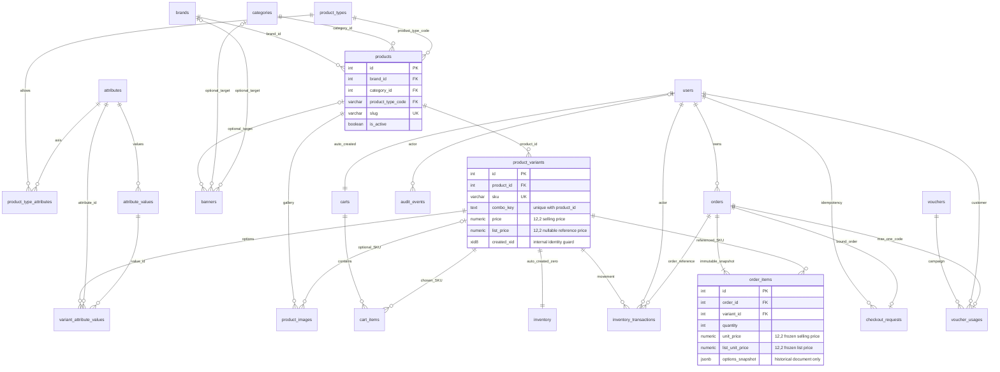

# ERD schema PostgreSQL đã triển khai

Ngày 20/11/2026. Schema `app`, migrations 001–016, PostgreSQL 17.9. Đã triển khai **đầy đủ 22 bảng** khớp ERD mục tiêu trong [DATABASE_DESIGN](DATABASE_DESIGN.md) (gồm cả `checkout_requests` và `audit_events` từ Task 04). Xem thêm [SCHEMA_VERIFICATION](SCHEMA_VERIFICATION.md).

## Các quan hệ cần đọc kèm ràng buộc

- Brand/category một–nhiều product; không seller hoặc warehouse_id. Product_type quyết định cấu trúc SKU, không suy ra từ category.
- Product_images có FK product_id và FK ghép (product_id,variant_id), nên ảnh không thể trỏ SKU thuộc product khác. Hai partial unique indexes bảo đảm tối đa một primary trong scope product hoặc SKU.
- Variant_attributes PK (variant_id,attribute_id), FK ghép (attribute_id,value_id), allowlist theo type và deferred required-axis check. combo_key do DB tính từ cặp ID đã sort, là khóa ứng viên kỹ thuật, không payload người dùng.
- Inventory và cart được tạo tự động bằng trigger; deferred guard chặn mất dòng 1–1. Không có bảng kho thứ hai hoặc giữ hàng khi thêm giỏ.
- Order_items phải được insert trong transaction tạo order, không UPDATE/DELETE, giá/tên/options snapshot tách khỏi catalog hiện tại. Order có ≥1 item và subtotal đúng tổng item khi commit.
- Voucher_usages có UNIQUE(order_id), FK ghép (order_id,user_id) và partial UNIQUE(voucher_id,user_id) WHERE APPLIED; RELEASED cho phép dùng lại trên đơn khác. Link order/code/status kiểm ở commit; counter used_count có CHECK phạm vi, việc cập nhật counter nguyên tử thuộc T07/T09/T10.
- Inventory_transactions có FK order nullable: IMPORT không order; EXPORT_ORDER/RETURN_CANCEL bắt buộc order, đúng dấu quantity. Partial unique theo order/SKU/type chặn log kép, không chỉ theo order.
- Banners CHECK target_type khớp đúng một FK hoặc NONE. Một banner không đồng thời trỏ brand, category và product.

## Chuẩn hóa và ngoại lệ có chủ đích

Catalog, thuộc tính, giỏ và các quan hệ FK tách theo phụ thuộc khóa, không lưu brand/category text lặp trong product hoặc list size dưới dạng CSV. Nguồn lựa chọn SKU là bảng quan hệ, không JSONB tự do; mỗi giá trị phụ thuộc vào attribute, mỗi SKU option phụ thuộc variant+attribute. Các bảng này hướng tới ít nhất 3NF.

Các cột snapshot trong orders/order_items là chứng từ lịch sử có chủ đích; thay tên/giá catalog không được sửa chứng từ. combo_key là dữ liệu dẫn xuất phục vụ UNIQUE và được DB đồng bộ; inventory.quantity/vouchers.used_count là số dư/counter gốc theo SPEC. Không tuyên bố toàn bộ mô hình không có dữ liệu dư thừa hoặc các counter đã được đối soát tự động bởi Task03.

Dictionary chi tiết mục tiêu nằm trong [DATABASE_DESIGN](DATABASE_DESIGN.md), phần ghi chú Task03 chỉ rõ khác biệt hiện tại. Cú pháp và constraints thực thi có thẩm quyền nằm ở [migrations](../database/migrations/001_namespace_roles.sql). Script role/backup: [roles_backup.sql](../database/roles_backup.sql). Hướng dẫn vận hành: [MIGRATION_GUIDE](MIGRATION_GUIDE.md). Kết quả kiểm chứng: [SCHEMA_VERIFICATION](SCHEMA_VERIFICATION.md).
